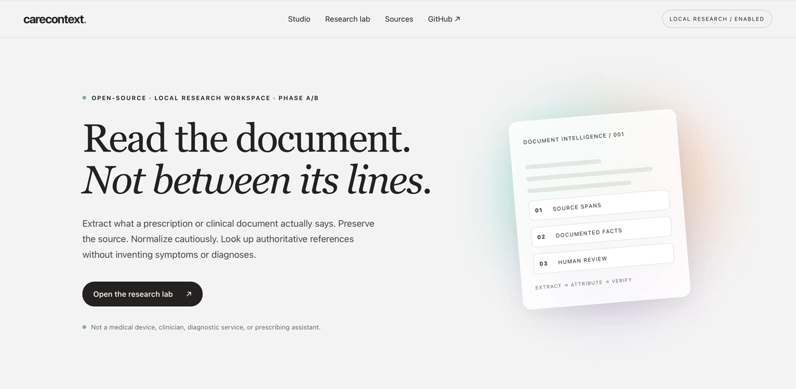
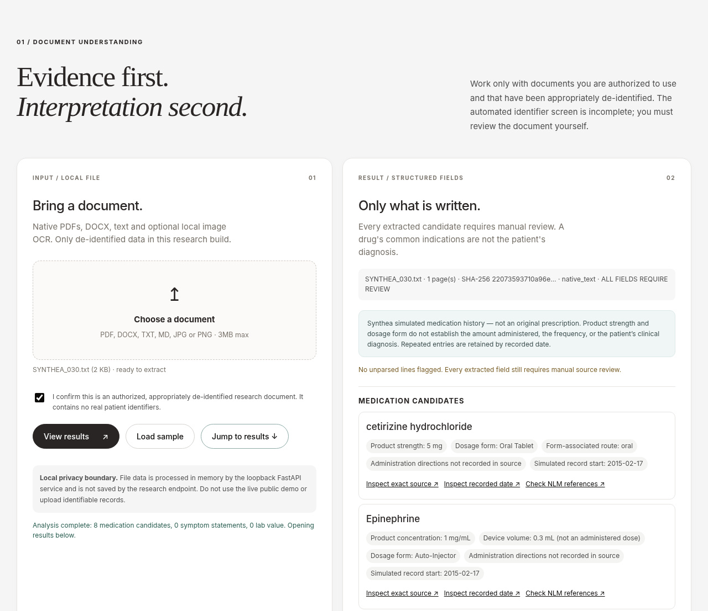

# CareContext-AI

**Clinical document intelligence with inspectable evidence.**

<p align="center"></p>

**v0.4.0a1 | Clinical Intelligence Research Alpha | Open source | MIT license**

CareContext is a local research application built by [Harikrishna Trivedi](https://github.com/HK0922) through AI-assisted development and human supervision. It extracts structured information from clinical documents, preserves exact source passages, and provides a way to inspect authoritative medical references without inventing symptoms, diagnoses, or treatment instructions.

[Get started](#get-started) · [Architecture](docs/ARCHITECTURE.md) · [Research implementation](docs/CLINICAL_INTELLIGENCE_PHASE1.md) · [Evaluation](docs/EVALUATION.md) · [Data registry](data/registry.json) · [Latest release](docs/RELEASE_V04_SYNTHEA.md)

> **Research alpha:** CareContext is not clinically validated. The Research Lab accepts only simulated or appropriately authorized and de-identified research documents. Do not use it for clinical decisions or upload identifiable patient records. The 85% clinical accuracy research target has not been established.

## Why I built it

Growing up around doctors and healthcare professionals made me curious about how technology could help people understand the information inside medical records. The challenge is not simply generating an answer. It is identifying what a document actually supports, what information is missing, and what needs human review.

CareContext explores that problem through a reproducible, evidence-first engineering workflow. It keeps the source visible throughout the process, rather than treating a fluent AI response as proof of medical accuracy.

## What's new in v0.4

The Clinical Research Lab introduces a dedicated workflow for extracting and reviewing medication information, laboratory values, and explicitly documented symptom statements.

* **Document ingestion:** PDF, DOCX, TXT and Markdown support, with optional local OCR for images. Documents are processed within configured size and page limits.
* **Structured clinical extraction:** Rule-based identification of candidate medication names, product strengths, concentrations, doses, routes, frequencies, durations, laboratory values and explicit symptom statements.
* **Medication history parsing:** Preserves combination products, auto-injector details, recorded dates and documented context. Repeated entries at different dates remain separate.
* **Source provenance:** Exact page references, text offsets, source excerpts and SHA-256 document fingerprints make extraction results independently inspectable.
* **Reference lookup:** Optional RxNorm and DailyMed metadata lookups use confirmed medication terms only. Uploaded documents are not sent to these services.
* **Uncertainty handling:** Separates recorded product strength from patient administration dose. Missing information remains missing, and all extracted candidates require source review.
* **Local research boundary:** Research mode is disabled by default and restricted to the loopback interface. Input processing is in memory. Users may export results as JSON.

The Research Lab uses a conservative extraction baseline rather than an autonomous clinical language model. Its output does not constitute a diagnosis, validated drug identification, or a treatment recommendation.

## Clinical Research Lab demonstration

<p align="center"></p>

*Actual v0.4 Research Lab interface, using a Synthea-generated medication history. All patient data in this demonstration is simulated.*

The corrected parser recognizes all eight dated medication entries in the supplied `SYNTHEA_030.txt` regression example, including epinephrine device information and both ingredients of amoxicillin/clavulanate. Hydrocortisone concentration is preserved instead of being misclassified as a weight-based dosing instruction. The interface explicitly indicates when administration directions are not recorded.

This example is a functional regression test, not a measurement of clinical accuracy. See the [Synthea parsing notes](docs/SYNTHEA_HISTORY_PARSING.md) and [demo documentation](docs/LINKEDIN_DEMO_V04.md).

## Get started

Requirements: Python 3.11 through 3.15. Node.js 22 or newer is optional for frontend tests. No frontend build or model credentials are required for local extraction.

Clone the repository and enter the project folder:

```bash
git clone https://github.com/HK0922/carecontext-ai.git
cd carecontext-ai
```

### macOS

Start the Clinical Research Lab with the provided launcher:

```bash
CARECONTEXT_RESEARCH_MODE=1 zsh RUN_ON_MAC.command
```

To enable optional RxNorm and DailyMed medication reference lookups:

```bash
CARECONTEXT_RESEARCH_MODE=1 CARECONTEXT_RESEARCH_NETWORK=1 zsh RUN_ON_MAC.command
```

Open [http://127.0.0.1:8000/research](http://127.0.0.1:8000/research). Select a simulated or appropriately authorized, de-identified document, confirm the research-use attestation, and extract fields. Inspect each source before interpreting the results.

The launcher prepares a virtual environment and installs the Python dependencies. More information is available in [START_HERE_MAC.md](START_HERE_MAC.md).

### Manual setup

```bash
python3 -m venv .venv
source .venv/bin/activate
python -m pip install -r requirements.txt
CARECONTEXT_RESEARCH_MODE=1 carecontext serve
```

On Windows PowerShell, activate with `.venv\Scripts\Activate.ps1`, set `$env:CARECONTEXT_RESEARCH_MODE = "1"`, and run `python -m carecontext.cli serve` after installing the requirements.

The server binds to `127.0.0.1` by default. Run one server process and keep the terminal open while using the application. See [Setup](docs/SETUP.md) for additional instructions.

## Workspaces

* **Research Lab (`/research`):** The v0.4 document extraction and source inspection workspace. Explicit local research mode is required.
* **Document Intelligence Studio (`/studio`):** The v0.3 fictional-document upload and conversation interface, with patient, clinician and researcher perspectives. Local retrieval and optional AI-assisted explanation remain available for fictional data only.
* **Classic workspace (`/classic`):** The original synthetic case viewer, dated evidence retrieval, review notes and evaluation tools. Includes three fictional wound-care coordination cases and 12 documents.
* **Literature workspace:** Search PubMed, filter by study type and year, inspect abstracts, open original publications and export citation lists. The live NCBI E-utilities integration transmits search terms to NCBI. Never include patient information. It does not generate clinical recommendations.

Run `zsh RUN_ON_MAC.command` without the research flags to use the existing fictional-data Studio. The [offline preview](OFFLINE_PREVIEW.html) is available for visual review, but it does not run the Python backend.

Read the [v0.3 Studio guide](docs/V0_3.md) and [Literature guide](docs/LITERATURE.md) for previous capabilities.

## How the evidence flows

```text
Document intake and research-use checks
                 |
                 v
Text extraction and document fingerprint
                 |
                 v
Format-aware clinical field extraction
                 |
                 v
Candidate fields with exact source spans
                 |
                 v
Human source inspection and optional NLM lookup
                 |
                 v
Review and JSON export
```

The original evidence retrieval system ranks sentence-level passages using BM25 within a selected case and date range. The optional model selector chooses passage IDs from retrieved fictional sources. Source validation checks the selected evidence before displaying exact excerpts. Unknown or wrong-case citations are rejected.

Experimental hybrid retrieval combines BM25 with optional local dense vectors and reciprocal rank fusion. It is not enabled for clinical answers pending independent evaluation.

Exact provenance makes information inspectable. It does not prove that the underlying document is medically correct, complete, current, or relevant enough to support a clinical conclusion.

## Optional model-assisted mode

The Research Lab itself does not use an LLM. The historical synthetic workspaces provide optional model-assisted functionality.

Set credentials on the server before starting the application:

```bash
export OPENAI_API_KEY="your-key"
export CARECONTEXT_MODEL="your-structured-output-capable-model-id"
carecontext serve
```

In the classic workspace, model-assisted selection sends the question and up to six retrieved fictional passages to the OpenAI Responses API using a strict JSON schema and `store: false`. Provider retention policies still apply. The selector returns passage IDs or abstains, rather than generating clinical prose.

The v0.3 Studio also supports an optional structured explanation mode for fictional documents with citation ID validation. This is separate from the clinical extraction baseline. Citation ID validation alone does not establish medical entailment or accuracy.

Local mode does not call the model. There is no browser API key field. `.env.example` is not loaded automatically. Live model execution remains unverified; the provider adapters were tested with mocked HTTP responses. Never send identifiable patient documents or restricted datasets to the model.

## Validation and evaluation

The v0.4 release was checked before publication with the following results:

* **122 Python tests passed** on Python 3.13.5.
* **5 frontend tests passed** on Node.js 22.16.0.
* **Release checks passed**, including local documentation links and frontend IDs.
* **GitHub Actions:** [Successful v0.4 validation run](https://github.com/HK0922/carecontext-ai/actions/runs/45664578416).
* Desktop and mobile browser interaction checks covered document selection, results display and source inspection. The supplied Synthea example returned eight medication entries.
* The original 24 labeled synthetic retrieval checks are part of the Python suite. The bundled classic evaluation reports expected-source recall at six of 1.00 and zero wrong-case passages. These are author-written fixtures, not independent clinical tests.

Run the checks locally with an activated virtual environment:

```bash
python -m pytest
npm run check
npm test
carecontext evaluate
python scripts/evaluate_clinical.py
python scripts/check_release.py
```

The clinical evaluation harness reports field-level results and confidence intervals. Independent real prescription evaluation, clinically reviewed ground truth, robust handwriting OCR, validated drug normalization, and external medical claim verification remain future work. The NLM integration was mock-tested during development; the demonstration includes a reference lookup, which is not a clinical validation study. Docker runtime and live model execution were not exercised in the release checks.

**No independent 85% clinical accuracy claim is made.** See [Evaluation methodology](docs/EVALUATION.md), [classic evaluation results](evaluations/results.json), and [clinical regression results](evaluations/clinical/author_written_results.json).

## Technology

* **API and validation:** Python, FastAPI, Pydantic and Uvicorn.
* **Document intelligence:** pypdf, native text and DOCX extraction, optional Pillow and Tesseract OCR.
* **Clinical parsing:** Conservative rules, format-aware medication histories, provenance spans and explicit missing-field handling.
* **Retrieval:** In-process BM25, optional experimental dense retrieval and reciprocal rank fusion.
* **External references:** HTTPX, NLM RxNorm, DailyMed and PubMed.
* **Optional model integration:** OpenAI Responses API with structured output contracts.
* **Persistence:** SQLite for the classic review history. Research analysis is held in memory and is not stored by its endpoint.
* **Frontend:** Semantic HTML, CSS and browser-native JavaScript. The off-white Editorial design uses light serif display type, warm ink, subtle borders and pastel atmospheric gradients.
* **Testing and delivery:** pytest, HTTPX mock transport, Node test runner, GitHub Actions, Python packaging, Docker and Compose.

## Repository guide

```text
carecontext/
  api.py                 FastAPI routes and request validation
  clinical_extract.py    Structured clinical extraction
  studio_ingest.py       Document text extraction and fingerprints
  research_privacy.py    Research input checks
  medical_references.py  RxNorm and DailyMed adapters
  hybrid_retrieval.py    Experimental hybrid retrieval
  retrieval.py          BM25 baseline
  engine.py             Selection, abstention and source verification
  studio_chat.py         Fictional-document conversation
  providers.py          Optional model selector
  catalog.py            Synthetic case boundaries and dated records
  store.py              SQLite history and exports
  evaluation.py         Labeled fixture evaluation
  data/                 Synthetic records and evaluation cases
  web/                  Complete frontend
  
data/                   Research data source registry
docs/                   Architecture, design, safety and release notes
evaluations/            Recorded evaluation results
scripts/                Dataset registry, evaluations and packaging
tests/                  Backend, frontend and regression tests
.github/                CI and collaboration templates
```

## Data, privacy and safety

The [data registry](data/registry.json) documents public reference services, dataset access conditions, licenses and acquisition policies. Restricted medical datasets are not bundled. The classic and Studio workspaces use fictional data only. The Research Lab is intended for simulated or appropriately authorized and de-identified research documents, never identifiable patient intake.

Research input checks are limited heuristics, not a de-identification service or compliance certification. Research mode has no clinical validation, multi-tenant isolation, or production privacy architecture. Do not enable it on a public host. A successful extraction does not authorize medical use, and a drug reference does not establish a patient's diagnosis or prescribed dose.

The original [hosted preview](https://carecontext-ai-preview.vercel.app/) is a separate synthetic-data deployment. Publishing the v0.4 source does not automatically update it.

## Documentation and contributing

* [Clinical intelligence implementation and limits](docs/CLINICAL_INTELLIGENCE_PHASE1.md)
* [Release notes](docs/RELEASE_V04_SYNTHEA.md) and [Changelog](CHANGELOG.md)
* [API contract](docs/API.md) and [System architecture](docs/ARCHITECTURE.md)
* [Editorial design system](docs/EDITORIAL_DESIGN_SYSTEM.md) and [Visual design](docs/DESIGN.md)
* [Data card](docs/DATA_CARD.md) and [Scope and safety](docs/SAFETY.md)
* [Roadmap](docs/ROADMAP.md) and [Demo](docs/DEMO.md)
* [AI-assisted development](docs/AI_WORKFLOW.md) and [Portfolio notes](docs/PORTFOLIO.md)
* [Publishing instructions](PUBLISHING.md)

See [CONTRIBUTING.md](CONTRIBUTING.md) and [SECURITY.md](SECURITY.md). Use synthetic reproduction steps and relevant regression tests when reporting issues. Project code, fixtures and original visual assets are available under the [MIT license](LICENSE). Dependency licenses remain with their respective authors; see [THIRD_PARTY_NOTICES.md](THIRD_PARTY_NOTICES.md).
