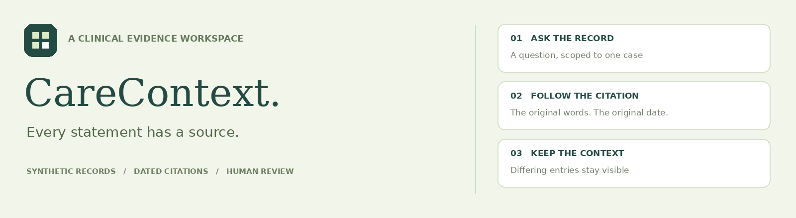
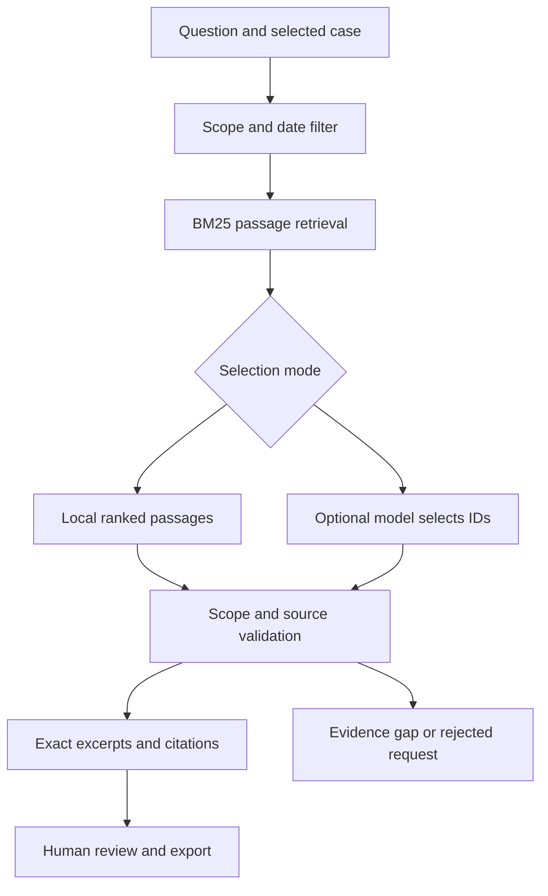

<p align="center"></p>

# CareContext

**Ask a clinical record a question. Inspect the source before trusting the answer.**

CareContext is a working local evidence-review application built by [Harikrishna Trivedi](https://github.com/HK0922) through AI-assisted development and human supervision. It retrieves passages from fictional patient records, attaches dated citations, surfaces differing recorded values, and preserves the result for human review.

[Get started](#get-started) · [Architecture](docs/ARCHITECTURE.md) · [Evaluation](docs/EVALUATION.md) · [Publish on GitHub](PUBLISHING.md) · [Demo walkthrough](docs/DEMO.md)

**Status:** v0.2.0 · synthetic research prototype · local application · MIT licensed

## New in v0.2: Literature workspace

A question-first research interface inspired by evidence-search products, implemented with an original CareContext design. Search PubMed, filter by study type and year, inspect structured abstracts and linked publication notices, open original sources, and export citation lists. No OpenEvidence content, branding, licensed corpus, or private API is used.

The Literature tab uses live NCBI E-utilities. It needs internet access and sends the entered search terms to NCBI. Never include patient information. It returns sources, not a generated clinical recommendation. The original synthetic case workspace remains available under Workspace.

See [Literature guide](docs/LITERATURE.md) for capabilities, limitations, and verification status.

## Why I built it

My healthcare software experience led me to a practical question: how can a reviewer quickly find relevant context without losing sight of the underlying record? CareContext explores that question through a small, inspectable retrieval pipeline. It treats missing information as a gap and preserves differing dated entries for human review.

The initial scope is specific: three fictional wound-care coordination cases, 12 documents, and a workflow that can be reproduced without model credentials.

## What it does

| Capability | Behavior |
| --- | --- |
| Case workspace | Switch between three synthetic cases and inspect the dated timeline. |
| Evidence retrieval | BM25 ranks sentence-level passages within the selected case. |
| Source inspection | Every excerpt links to its complete original fixture document. |
| Date filters | Restrict retrieved evidence to records available by a chosen date. |
| Record changes | Preserve both older and newer values for annotated fields. |
| Optional model selection | A configured model selects passage IDs; it does not author displayed clinical prose. |
| Excerpt checker | Reject unknown, changed, partial, or wrong-case citations. |
| Review handoff | Save notes in SQLite; export Markdown or JSON with a corpus fingerprint. |
| Evaluation lab | Run 24 labeled fixture checks from the UI or CLI. |

**Synthetic data only.** Records and workflow references are author-written fiction, not medical guidelines. The app does not diagnose, prescribe, assess urgency, or connect to an EHR. It has no clinical validation or compliance certification. Do not enter real patient details in questions or review notes. See [Scope and safety](docs/SAFETY.md).

## Get started

Requirements: Python 3.11–3.13. Python 3.12 was validated locally. Node.js 22+ is optional, for frontend utility tests. No frontend build or model download is required.

Download this repository or clone it after publishing:

```bash
git clone https://github.com/HK0922/carecontext-ai.git
cd carecontext
python -m venv .venv
source .venv/bin/activate
python -m pip install -r requirements.lock
python -m pip install --no-deps -e .
carecontext serve
```

On Windows PowerShell, replace activation with `.venv\Scripts\Activate.ps1`. You can also invoke `.venv\Scripts\python.exe -m carecontext.cli serve` after installing with that interpreter.

Open **http://127.0.0.1:8000**. Select Maya Chen and click **What allergy information changed?** Open a numbered citation to compare the original records.

The server binds to `127.0.0.1`. Run one server process. Local reviews are stored in `.data/carecontext.sqlite3`, excluded from version control. More instructions: [SETUP.md](docs/SETUP.md).

## How the evidence flows



This is an extractive retrieval architecture. Local mode uses no LLM. Model mode is retrieval-augmented evidence selection, not free-form answer generation. Exact quotation makes provenance inspectable; it does **not** prove that a source is medically correct, current, complete, or relevant enough.

## Optional model-assisted mode

Set credentials **on the server**, before starting:

```bash
export OPENAI_API_KEY="your-key"
export CARECONTEXT_MODEL="your-structured-output-capable-model-id"
carecontext serve
```

Choose **Model-assisted selection** in the interface. Your question and up to six retrieved fictional passages are sent to the OpenAI Responses API. The request uses a strict JSON schema and `store: false`; provider retention policies still apply. The model selects valid passage IDs or abstains. Unknown IDs, failed requests, and incomplete responses do not produce a saved answer.

There is no browser API-key field. `.env.example` is **not automatically loaded**. Local mode never calls the model. Live model execution was not tested during this build; the adapter was tested with mocked HTTP responses.

## Validation

```bash
python -m pytest
npm run check
npm test
carecontext evaluate --output evaluations/results.json
python scripts/check_release.py
```

| Check | Observed result |
| --- | --- |
| Python tests | 77 passed |
| Frontend utility tests | 5 passed |
| Labeled fixture evaluation | 24 of 24 passed |
| Expected-source recall at 6 | 1.00 on the bundled evaluation |
| Wrong-case passages returned | 0 in the bundled evaluation |
| Live model / Docker runtime | Not exercised |
| Browser interaction and visual QA | Unverified; preview infrastructure was unavailable |

The 24 evaluation cases are also included in the Python suite, not independent additional tests. Exact-source matching is enforced by construction. The suite is author-written, not a held-out clinical benchmark. See [methodology](docs/EVALUATION.md) and [actual results](evaluations/results.json).

## Technology

| Layer | Choice |
| --- | --- |
| API and contracts | Python, FastAPI, Pydantic |
| Retrieval | In-process BM25, token normalization, explicit fixture tags |
| Model adapter | Optional OpenAI Responses API through HTTPX |
| Persistence | SQLite with parameterized queries and answer snapshots |
| Interface | Semantic HTML, CSS, browser-native JavaScript modules |
| Tests and CI | pytest, HTTPX mock transport, Node test runner, GitHub Actions |
| Packaging | Python package, wheel, Dockerfile, Compose, source ZIP |

## Repository guide

```text
carecontext/
  api.py            HTTP routes and request validation
  catalog.py        Corpus, patient boundaries, dated changes
  retrieval.py      BM25 baseline and normalization
  engine.py         Selection, abstention, verification
  providers.py      Optional model selector
  store.py          SQLite history and exports
  evaluation.py     Labeled fixture evaluation
  data/             Synthetic records and evaluation cases
  web/              Complete interface, no build step
tests/              Backend, provider, API, frontend checks
docs/               Design, setup, API, demo, portfolio notes
evaluations/        Recorded results
scripts/            Fixture generation and release packaging
.github/            CI and collaboration templates
```

## Documentation

- [Setup](docs/SETUP.md) and [API contract](docs/API.md)
- [System design](docs/ARCHITECTURE.md) and [visual design](docs/DESIGN.md)
- [Evaluation](docs/EVALUATION.md), [data card](docs/DATA_CARD.md), and [safety boundaries](docs/SAFETY.md)
- [Demo](docs/DEMO.md), [roadmap](docs/ROADMAP.md), and [portfolio talking points](docs/PORTFOLIO.md)
- [AI-assisted development](docs/AI_WORKFLOW.md) and [LinkedIn draft](docs/LINKEDIN_POST.md)

## Contributing and license

See [CONTRIBUTING.md](CONTRIBUTING.md), [SECURITY.md](SECURITY.md), and [CHANGELOG.md](CHANGELOG.md). Use synthetic reproduction steps and relevant tests. Project code, fixtures, and original visual assets use the [MIT license](LICENSE). Dependency licenses remain with their authors; see [THIRD_PARTY_NOTICES.md](THIRD_PARTY_NOTICES.md).
